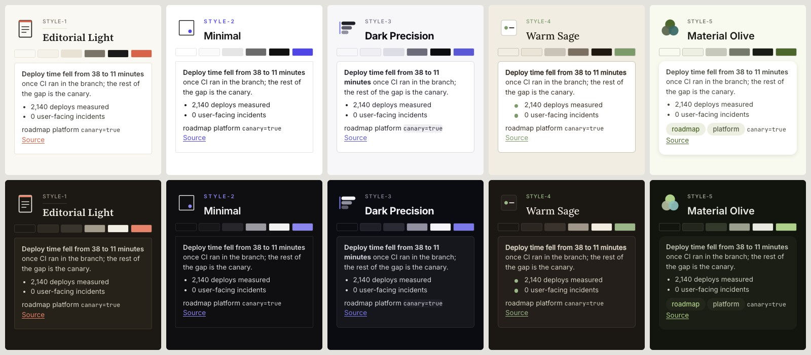
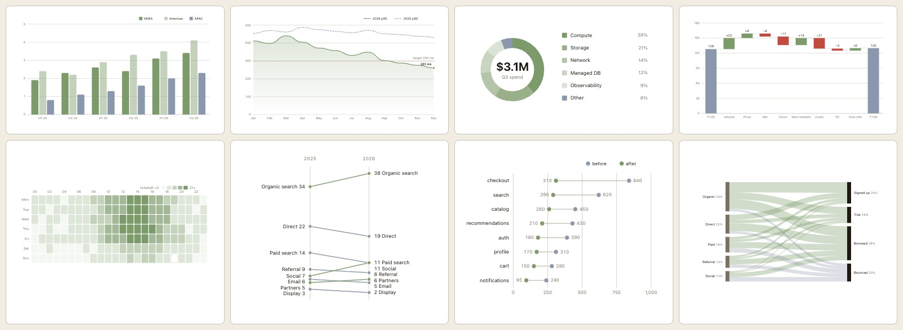
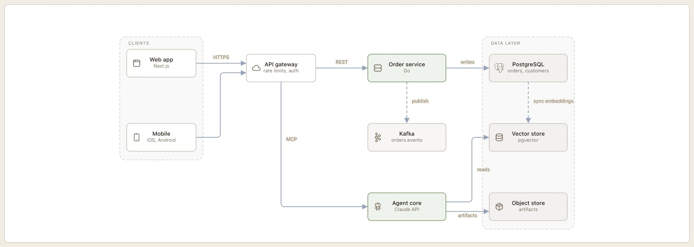

# SWE Marketplace

A collection of Claude Code plugins for everyday software engineering and knowledge work.

Claude is already great at creating slides or charts or HTML pages, but I find that there are always adjustments and fine-tuning that I want to make for more polished results: use these style elements here, reorganize the generated HTML this way, make the chart look like this... Over many months of software development and knowledge work, these small improvements add up to days or weeks of time and loads of tokens. The **knowledgeware** plugin sets helpful conventions and a unified style (a "brandbook") for generated artifacts: HTML knowledge bases, charts and flow diagrams, and presentations in PowerPoint or HTML (with speaker notes, if requested).

Use **research-team** to run deep research on a given topic and produce template-formatted output (a technical survey, a technical rundown, a decision brief, a landscape scan, a what's-new digest or a source summary) with consistent formatting and cited sources.

More experimental tools like **adv** help you review your code with Claude, Codex and Gemini at once, and **context-engineering** helps you translate business objectives into custom agentic resources according to best practices. Plus: 49 specialist starter agent templates for languages, frameworks, clouds and databases.

Each plugin installs on its own, so feel free to add only what you'll use.

[](./LICENSE)
[](https://github.com/andisab/swe-marketplace/actions/workflows/validate-plugins.yml)
[](./.claude-plugin/marketplace.json)
[](https://code.claude.com/docs/en/plugins)
[](https://www.skillsdirectory.com/authors/andisab)

## Start here

Find the row that matches what you want to do, install that plugin, and then ask Claude for something like the example.

| You want to… | Install | Then ask Claude |
|---|---|---|
| Make slide decks, knowledge-base sites or diagrams in one consistent style | [`knowledgeware`](./plugins/knowledgeware/) | *"Make a 6-slide HTML deck on our Q3 results in style-3"* |
| Get a second and third opinion on code changes | [`adv`](./plugins/adv/) | *"Use the adv-review agent to review my uncommitted changes"* |
| Research a topic with parallel agents and get one written report | [`research-team`](./plugins/research-team/) | *"Use research-team to research vector database pricing"* |
| Build your own agents, skills, hooks, plugins or MCP servers | [`context-engineering`](./plugins/context-engineering/) | *"Help me create a skill that drafts our release notes"* |
| Bring in a specialist for a language, framework, cloud or database | [`dev`](./plugins/dev/), [`frontend`](./plugins/frontend/), [`infrastructure`](./plugins/infrastructure/), [`databases`](./plugins/databases/), [`data`](./plugins/data/), [`machine-learning`](./plugins/machine-learning/), [`genai`](./plugins/genai/) | *"Have the Terraform engineer review this module"* |
| Write PRDs and project plans | [`product-management`](./plugins/product-management/) | *"Draft a PRD for single sign-on"* |
| Keep CLAUDE.md files accurate as the code changes | [`arch`](./plugins/arch/) | *"Update CLAUDE.md for the changes on this branch"* |

To install one, run this in Claude Code (v2.1.275 or later), with any plugin name from the table in place of `knowledgeware`:

```
/plugin install knowledgeware --marketplace andisab/swe-marketplace
```

[Install](#install) is one command; [docs/install.md](./docs/install.md) covers older Claude Code versions, shells, teams, Claude Desktop, claude.ai and the Agent SDK. The [catalog](#catalog) lists every skill, command and agent. The plugins fall into three groups: knowledgeware and research-team are the ones I maintain most actively; adv and context-engineering are experimental; the other nine are agent packs, a set of agent definitions each and nothing more.

## What knowledgeware makes

The sections below show one image per skill, in the order the [knowledgeware README](./plugins/knowledgeware/README.md) uses; that README also holds the five styles, the brands directory, the librarian and the troubleshooting notes.

### **knowledgebase**: sites for technical material a team references and maintains


*Two pages from the knowledgebase template: a PostgreSQL upgrade runbook in the default palette and an incident review in a dark one.*

knowledgebase builds multi-page HTML sites for runbooks, field guides and incident reviews. A page is one HTML file with sidebar navigation, an on-page table of contents, callouts for traps and tips, Mermaid diagrams, tables, and a dated "last verified" stamp under any fact that goes stale. The dark page is the same template with its CSS variables set from another style, and nothing else changed. The plugin's librarian agent reads those stamps and re-verifies what's due.

### **brandware**: a style registry the other skills read



*The five built-in styles in light and dark, each with its mark, palette swatches and a sample card from its own stylesheet.*

A style or brand is one folder: a brandbook in Markdown that states the palette, type and layout rules, a derived token file, the marks and logos, and a stylesheet. The five styles ship with the plugin, each with a light and a dark palette. A brand of your own goes in a directory you point the plugin at, so it survives plugin updates and shadows a built-in style of the same name, and a `.knowledgeware` file in a repository pins the brand for that project. Decks, sites and charts then share one identity without being told twice.

### **chartware**: charts and diagrams in three media modes



*Eight of chartware's chart templates with fuller data, inlined in a page that sets the Warm Sage style: grouped bars, line and area, donut, waterfall, heatmap, slopegraph, dumbbell and Sankey.*



*A flow diagram from the same template family: nine nodes in two groups, orthogonal edges through the gutters, icons from the sprite, and nothing the geometry lint objects to.*

chartware picks the medium by fit: Mermaid for diagrams that live in Markdown, hand-authored SVG for data charts and figures that must be exact, and draw.io through its bundled MCP server for diagrams someone will keep editing. The SVG templates carry their scale math in comments and read the page's theme tokens, so a chart inlined in a knowledgebase page turns dark with the page. A geometry lint checks a diagram's routing, labels and clipping before anything is rendered, and an existing draw.io, Mermaid or Excalidraw diagram can be redrawn in any medium with a ledger of what was kept, renamed or dropped.

### **slideware**: decks in PowerPoint or HTML


*Six slides from three HTML decks, each in a built-in style: Editorial Light, Dark Precision and Material Olive.*

slideware builds a deck from a short outline: a `slides.js` file with one descriptor per slide, naming a layout and holding the content. It renders to PowerPoint through pptxgenjs, or to a single HTML file with Reveal.js inlined, so the HTML deck runs offline and travels as one file. Styles come from the shared registry, so one outline renders in any of the five built-in styles or in your brand; the decks above differ only in the style name. The charts on the slides are chartware templates placed as figures.


*The big-number slide beside its presenter view: previous and next slides, the session timer with per-slide pacing, and the formatted speaker notes.*

Press "S" or "P" in an HTML deck and a second window opens with this view, kept in sync with the audience window. Notes are written in the slide descriptors, with `[pause]` markers and bold where you want them. The pacing plan comes from the deck's total minutes or from named sessions, and the header says whether you're ahead or behind. A slide marked hidden stays out of the deck and out of the plan.


## Install

In Claude Code, run this once per plugin (knowledgeware shown; the other names are in the [catalog](#catalog)):

```
/plugin install knowledgeware --marketplace andisab/swe-marketplace
```

Confirm the marketplace the first time it asks, pick **Install for you (user scope)**, and the plugin is active. On Claude Code older than v2.1.275, add the marketplace first with `/plugin marketplace add andisab/swe-marketplace`, then install with `/plugin install knowledgeware@swe-marketplace`.

In Claude Desktop, open **Customize → Plugins → Add → Add marketplace**, enter `andisab/swe-marketplace`, and turn on the plugins you want. Skills and commands run everywhere; agents run in Claude Code and Cowork, not in Desktop chat or claude.ai.

For updates, open `/plugin` → **Marketplaces** → **swe-marketplace** → **Enable auto-update**. `adv` also needs Codex CLI and Gemini CLI signed in, and `knowledgeware` needs Node.js; each plugin's README states what it needs and why. Shell commands, team settings, local clones, zip uploads, the Agent SDK and what runs where are in [docs/install.md](./docs/install.md).

## Catalog

### Core plugins

The two plugins I use daily and keep current. Both carry scripts, templates and tests of their own, and their versions move the most.

| Plugin | Version | What it's for | Contents |
|---|---|---|---|
| [`knowledgeware`](./plugins/knowledgeware/) | 1.10.0 | Slide decks (PowerPoint, or HTML with a presenter view), offline HTML knowledge bases, diagrams and charts, all in one style from a shared registry. A librarian agent keeps sites and decks current. | 1 agent · 4 skills · 2 commands · 1 MCP server |
| [`research-team`](./plugins/research-team/) | 1.3.0 | Multi-agent web research. Parallel researchers take one subtopic each, then a writer turns their notes into one report, as plain Markdown or formatted for Obsidian or Joplin. | 2 agents · 2 skills |

### Experimental plugins

Both work, and both change: adv depends on the Codex and Gemini CLIs, whose flags and models change between months, and context-engineering teaches conventions that Anthropic's plugin and skill guides keep updating. Expect their interfaces to move between minor versions.

| Plugin | Version | What it's for | Contents |
|---|---|---|---|
| [`adv`](./plugins/adv/) | 0.4.0 | Adversarial multi-model code review. Claude, Codex CLI and Gemini CLI review in parallel, then cross-examine each other's findings. | 1 agent · 1 skill · 3 commands |
| [`context-engineering`](./plugins/context-engineering/) | 1.1.1 | The plugin for building other plugins: agents, skills, commands, hooks, plugins, MCP tools and servers, to Anthropic's specs. | 1 agent · 7 skills |

### Agent packs

One domain each, and nothing but agent definitions: no scripts, no MCP servers, nothing that runs on your machine beyond the agent's own tool calls. Install the pack for the stack you work in.

| Plugin | Version | What it's for | Contents |
|---|---|---|---|
| [`dev`](./plugins/dev/) | 1.0.1 | Specialists for 10 languages, FastAPI and Node.js, plus cross-language refactoring. | 13 agents |
| [`frontend`](./plugins/frontend/) | 1.0.1 | React, Vue, Next.js, HTML and CSS specialists, plus a designer that turns mockups into specs. | 6 agents |
| [`infrastructure`](./plugins/infrastructure/) | 1.0.1 | AWS, GCP, Docker, Kubernetes, Terraform, CI/CD and security audits. | 8 agents |
| [`databases`](./plugins/databases/) | 1.0.1 | SQL, NoSQL, graph and vector databases. | 7 agents |
| [`data`](./plugins/data/) | 1.0.1 | Visualization (D3, Highcharts), notebooks (Jupyter, Colab), R, and Python data engineering. | 6 agents |
| [`machine-learning`](./plugins/machine-learning/) | 1.0.1 | PyTorch, TensorFlow and scikit-learn. | 3 agents |
| [`genai`](./plugins/genai/) | 1.0.1 | LangChain and LangGraph applications. More frameworks on the way. | 1 agent |
| [`product-management`](./plugins/product-management/) | 1.0.1 | PRDs, project plans, and clear writing. | 3 agents |
| [`arch`](./plugins/arch/) | 1.0.1 | Repository housekeeping: CLAUDE.md context files, and Docker and Make workflows. | 2 agents |

Each plugin's README covers its components, examples and requirements. Versions are pinned in [`marketplace.json`](./.claude-plugin/marketplace.json), and the [changelog](./CHANGELOG.md) says what changed in each. To hear about new releases, watch this repository's releases (**Watch → Custom → Releases**).

### Skills

Claude loads a skill when your request matches the skill's description. You can also call one by name.

| Skill | What it does |
|---|---|
| `knowledgeware:knowledgebase` | Multi-page, offline HTML knowledge bases (field guides, handbooks, runbooks, study guides), each with a maintenance page so it can be kept current. |
| `knowledgeware:brandware` | The shared brand registry. It imports, derives or edits the brandbooks and logos that every deliverable uses. |
| `knowledgeware:chartware` | Architecture diagrams and data charts as Mermaid, hand-written SVG, or editable draw.io files. |
| `knowledgeware:slideware` | Slide decks as PowerPoint, or a single-file HTML deck that runs offline, with a presenter view, a section overview, session pacing and speaker notes. |
| `research-team:coordinator` | Runs the research pipeline. It splits a topic into subtopics, researches them in parallel, then has the report written. |
| `research-team:report-formats` | Format profiles (Markdown, Obsidian, Joplin) and six report types for the research reports. |
| `context-engineering:agent-dev` | Designing subagents: frontmatter, system prompt, tool access, example-driven descriptions. |
| `context-engineering:skill-dev` | Designing skills whose descriptions trigger at the right moments. |
| `context-engineering:command-dev` | Slash commands: arguments, file references, bash, frontmatter. |
| `context-engineering:hook-dev` | Hooks on lifecycle events, for formatting, logging, notifications and permission control. |
| `context-engineering:plugin-dev` | Plugin layout, manifests and marketplace distribution. |
| `context-engineering:mcp-tool-dev` | Individual MCP tools: schemas, descriptions, input validation. |
| `context-engineering:mcp-server-dev` | Complete MCP servers in Python (FastMCP) or TypeScript, packaged for `uvx` or `npx`. |
| `adv:dispatch` | Shared scripts behind adv's review and commands. You don't call it directly. |

### Commands

| Command | What it does |
|---|---|
| `/knowledgeware:librarian status \| plan \| sweep` | Reports what's due across a library of sites and decks, writes an update plan, or fact-checks one knowledgebase site against primary sources. Built for weekly scheduled runs. |
| `/knowledgeware:kb-maintain <site>` | Deprecated alias for `librarian sweep`, kept so existing scheduled jobs keep working. |
| `/adv:adv-codex <prompt>` | Sends a prompt to Codex CLI and returns its answer. |
| `/adv:adv-gemini <prompt>` | Sends a prompt to Gemini CLI and returns its answer. |
| `/adv:adv-gemini-research <query>` | Deep research through Gemini, grounded in Google Search. |

### Agents

An agent is a specialist with its own instructions and its own context window. Claude hands a task to an agent when the task matches the agent's description. You can also ask for one by name or pick it from `/agents`, where each one is listed as `<plugin>:<agent>`, such as `dev:python-expert`.

<details>
<summary><b>All 54 agents</b>, by plugin</summary>

| Plugin | Agent | Use it for |
|---|---|---|
| adv | `adv-review` | Five reviewers across Claude, Codex CLI and Gemini CLI, then cross-examination to filter false positives. |
| context-engineering | `context-engineer` | Designing and building Claude Code resources with the context-engineering skills. |
| research-team | `research-specialist` | Researching one subtopic through web search and saving a short, cited note. |
| research-team | `research-report-writer` | Synthesizing the research notes into a structured report. |
| knowledgeware | `librarian` | What's due across sites and decks, update plans, and fact-check sweeps of knowledgebase sites. |
| dev | `python-expert` | Modern Python: async, type safety, FastAPI / Pydantic / SQLAlchemy patterns. |
| dev | `fastapi-architect` | Production FastAPI services: Pydantic v2, async SQLAlchemy 2.0, auth, API design. |
| dev | `typescript-expert` | TypeScript 5.7+: strict typing, generics, type-level programming. |
| dev | `javascript-expert` | Modern JavaScript: async patterns, code quality, performance. |
| dev | `nodejs-expert` | Node.js 22+: ES modules, streams, event-driven architecture, security. |
| dev | `go-expert` | Idiomatic Go: concurrency and performance. |
| dev | `rust-expert` | Idiomatic Rust: ownership, concurrency, the type system. |
| dev | `cpp-expert` | Modern, efficient C++. |
| dev | `kotlin-expert` | Idiomatic Kotlin: coroutines, extension functions, memory. |
| dev | `php-expert` | Modern, secure PHP applications. |
| dev | `lua-expert` | Efficient, idiomatic Lua. |
| dev | `perl-expert` | Perl scripting: regular expressions, text processing, CPAN. |
| dev | `refactor-agent` | Refactoring in any language, without changing behavior. |
| frontend | `react-expert` | React 19+: hooks, concurrent rendering, Server Components, performance. |
| frontend | `vue-expert` | Vue 3: Composition API, script setup, TypeScript, Pinia, Nuxt 3. |
| frontend | `nextjs-expert` | Next.js 15+: App Router, Server Components, streaming. |
| frontend | `html-expert` | Semantic, accessible, well-structured HTML. |
| frontend | `css-expert` | Modern CSS: Grid, Flexbox, container queries, layers, nesting. |
| frontend | `frontend-designer` | Turning mockups and wireframes into implementation specs. |
| infrastructure | `aws-cloud-architect` | AWS architecture: service selection, cost, security. |
| infrastructure | `gcp-cloud-architect` | Google Cloud architecture: GCE, GKE, Cloud Run, App Engine. |
| infrastructure | `infra-docker-engineer` | Docker and Compose: image optimization, multi-container dev environments. |
| infrastructure | `k8s-engineer` | Kubernetes: manifests, Helm charts, operators, GKE and EKS. |
| infrastructure | `terraform-engineer` | Terraform: modules, state management, multi-cloud provisioning. |
| infrastructure | `github-actions-expert` | GitHub Actions: reusable workflows, OIDC, matrix builds, hardening. |
| infrastructure | `gitlab-ci-expert` | GitLab CI/CD pipelines: configuration, optimization, security. |
| infrastructure | `security-auditor` | Codebase security audits with a prioritized remediation report. |
| databases | `db-postgres-expert` | PostgreSQL 16+: tuning, indexing, replication, architecture. |
| databases | `db-mongodb-expert` | MongoDB 6/7: document modeling, aggregation, sharding. |
| databases | `db-neo4j-expert` | Neo4j 5: graph modeling, Cypher, GDS, APOC. |
| databases | `db-cassandra-expert` | Cassandra 4/5: data modeling, CQL, cluster tuning. |
| databases | `db-mariadb-expert` | MariaDB 10/11: replication, Galera clustering, performance. |
| databases | `db-sql-expert` | Advanced SQL and execution-plan tuning across major engines. |
| databases | `db-vector-expert` | Vector search: pgvector, Pinecone, Weaviate, Qdrant, FAISS. |
| data | `d3-expert` | Custom interactive visualizations in D3 v7+. |
| data | `highcharts-expert` | Interactive charts with Highcharts Core, Stock, Maps and Gantt. |
| data | `data-jupyter-expert` | Production-ready Jupyter and JupyterLab notebooks. |
| data | `google-colab-expert` | Google Colab workflows: GPU/TPU sessions, GitHub integration. |
| data | `data-r-expert` | R for statistics and data science: tidyverse, tidymodels, Quarto. |
| data | `python-data-engineer` | Python data pipelines: Pandas, Polars, PySpark, Airflow. |
| machine-learning | `pytorch-expert` | Deep learning models in PyTorch. |
| machine-learning | `tensorflow-expert` | Developing and deploying TensorFlow models. |
| machine-learning | `scikit-learn-expert` | scikit-learn: preprocessing, model selection, pipelines, tuning. |
| genai | `langchain-expert` | LangChain and LangGraph: LCEL chains, RAG, multi-agent systems. |
| product-management | `prd-writer` | Product requirements documents. |
| product-management | `project-planner` | Turning a PRD into a development task list. |
| product-management | `content-writer` | Clear articles and outlines on complex topics. |
| arch | `context-agent` | Keeping CLAUDE.md files in sync with the repository. |
| arch | `build-orchestrator` | Docker and Make workflows: images, containers, volumes, build targets. |

</details>

## FAQ

### Do I need to install everything?

No. Each plugin works on its own, and none of them requires another. Adding the marketplace installs nothing by itself. It only lets you install plugins from it by name.

### Is it free? Is it dangerous?

The plugins are free and MIT-licensed. They run on whatever Claude Code already uses, your Claude subscription or API account, so they count toward the same usage limits or bill. `adv` also calls Codex CLI and Gemini CLI, which use your OpenAI and Google accounts. Please use at your own risk and protect yourself at all times.

### What does a plugin run on my machine, and does anything leave it?

Most plugins here are instructions that Claude reads. Their agents and skills work through the tools Claude already has, and Claude asks before running commands or editing files whenever your permission settings require it. No plugin in this marketplace installs hooks, which are commands that run automatically on Claude Code events. Three plugins do more than that:

- **knowledgeware** runs its own Node.js and Python scripts on your machine to build and check decks. It also starts the official draw.io MCP server (`@drawio/mcp`, which `npx` downloads from npm on first use) to open diagrams in the draw.io editor.
- **adv** runs Bash scripts that send the code under review to Codex CLI and Gemini CLI, so that code goes to OpenAI and Google. It writes its reports to `.claude/reviews/` in your repository.
- **research-team** searches the web and writes its notes and reports to `~/Documents/Claude/Research/`.

Before you install a plugin from any marketplace, read the details pane that `/plugin install` opens. Anthropic's [plugin security guide](https://code.claude.com/docs/en/plugins/security) says what to look for.

### Will installing several plugins fill up Claude's context?

Each installed plugin adds the short descriptions of its skills and agents to every session, so Claude knows when to use them. The full instructions load only when Claude uses a skill or agent. To see what one plugin adds, run `claude plugin details <name>@swe-marketplace` in your shell and read the `Always-on` line. For knowledgeware 1.9.0 it reads about 1,500 tokens, under 1% of a 200,000-token context window. Disable plugins you aren't using with `claude plugin disable <name>@swe-marketplace`.

### How do I get updates?

Claude Code doesn't update plugins from third-party marketplaces such as this one until you turn that on. Run `/plugin`, open the **Marketplaces** tab, select **swe-marketplace** and choose **Enable auto-update**. To update by hand instead, choose **Update marketplace** on the same screen. A running session keeps the version it loaded, so run `/reload-plugins` or start a new session to use the new one. The [changelog](./CHANGELOG.md) lists what changed in each version.

### How is an agent different from asking Claude directly?

An agent starts with instructions written for its specialty and works in its own context window. Claude hands it the task, the agent does the reading and the work there, and only its report comes back. A long investigation therefore doesn't fill your main conversation. For a quick question, asking Claude directly works fine. To use an agent on purpose, name it in your request, as in *"have db-postgres-expert review this migration"*, or pick it from `/agents`.

### I added one skill from a skills directory, and it says it needs the whole plugin.

Skills directories copy a single skill folder. Some skills depend on files elsewhere in their plugin, such as scripts, styles or agents. slideware, brandware and research-team's coordinator check for those files, and when they're missing, the skill stops and prints the command that installs the whole plugin. Run that command. The context-engineering skills and research-team's `report-formats` are self-contained and work on their own.

### Can I use these plugins outside the terminal?

Yes, with limits. The Desktop app's Code tab and Cowork run these plugins, while Desktop Chat and claude.ai run only skills and commands, as [What runs where](./docs/install.md#what-runs-where) shows. Cloud sessions, including Claude Code on the web at claude.ai/code, don't load plugins you installed on your own machine.

### What isn't here?

Hooks, LSP servers, output styles and service connectors. For those, start with Anthropic's own marketplace, `claude-plugins-official`, which Claude Code adds for you; run `/plugin` to browse it. Before you add any other marketplace, check who publishes it: plugins can register hooks and MCP servers that run on your machine, so read what a plugin will run and review its permissions.

### Something doesn't work, or I'd like an agent added.

Open an [issue](https://github.com/andisab/swe-marketplace/issues). For a bug, include the output of `claude --version`, the plugin and version from `claude plugin list`, what you asked Claude, and what happened.

## Troubleshooting

**An install command ending in `@andisab-swe-marketplace` fails.** The marketplace registers under the name `swe-marketplace`, so the plugin name is, for example, `dev@swe-marketplace`. Some plugin directories print the longer form. Run `claude plugin marketplace list` to see the names of the marketplaces you've added.

**A skill or agent doesn't start when you ask.** Open `/plugin` and check the **Installed** tab to confirm the plugin is installed and enabled. If you installed it from a shell or in another session, run `/reload-plugins`. Two skills start only when you name them, the knowledgebase skill (*"use the knowledgebase skill to …"*) and research-team's coordinator (*"use research-team to research …"*). For the others, naming the skill or agent in your request is the most reliable way to start it.

**adv's review comes back from Claude alone.** adv falls back to Claude when Codex CLI or Gemini CLI is missing, signed out or out of quota, and its setup line names the reason (`auth`, `quota`, `timeout`, `model_not_found`). The usual causes are an expired `codex login`, a Gemini key that didn't reach the CLI (no variable set, or 1Password locked), and a free-tier Gemini key whose daily quota is gone. The [adv README](./plugins/adv/README.md#when-an-engine-fails) has a table of every failure class with its fix, and the health-check commands that show the reason in a second.

**A plugin installed but didn't load.** Open the **Errors** tab in `/plugin` for the reason, then look it up in Anthropic's [plugin troubleshooting guide](https://code.claude.com/docs/en/plugins/troubleshooting).

## How this marketplace is built

- **Curated.** Every plugin and agent is one I use. The marketplace holds no vendored collections and no generated stubs of skills the model already has.
- **Loads in the Agent SDK.** Every plugin ships its own `plugin.json` next to its catalog entry, so the Claude Agent SDK and `claude --plugin-dir` can load a plugin straight from a clone. When a marketplace ships only the catalog, those loaders don't register its skills, commands and hooks, and they don't report an error either.
- **Validated in CI.** Every pull request and push to `main` runs `claude plugin validate` on the catalog and every plugin and fails on any error or warning, including the plugin-directory checks for README install lines and icons. CI also checks that the generated manifests match the catalog, and it rejects agents that name tools Claude Code doesn't have.
- **Tested with evals.** I use skill-creator and my own eval harness to build and evaluate plugins, and most of the skills and plugins here have been through evals.

## Contributing

This is a never-ending labor of love. Thoughtful ideas, updates, agent improvements, doc fixes and bug reports are always welcome, and if you like the tools, please give the repo a star! If you'd like to contribute, [CONTRIBUTING.md](./CONTRIBUTING.md) has the full workflow.

The marketplace ships two manifests. The catalog, `.claude-plugin/marketplace.json`, is the source of truth that `/plugin marketplace add` and `/plugin install` read. Each plugin's `plugins/<name>/.claude-plugin/plugin.json` is generated from its catalog entry for loaders that read one plugin directly, and the plugin's `icon.png` sits beside it. Edit the catalog, then regenerate and validate:

```bash
python scripts/synthesize-plugin-manifests.py          # regenerate every plugin.json
python scripts/synthesize-plugin-manifests.py --check  # fail if any plugin.json has drifted (CI runs this)
python scripts/check-agent-tools.py                    # agent tool names (CI runs this)
./scripts/validate-all.sh                              # full validation (CI runs this)
git config core.hooksPath scripts/git-hooks            # optional: run the drift check before each commit
```

The pre-commit hook checks the staged files, not the working tree, so a commit with a stale `plugin.json` fails even when the tree is in sync. `git commit --no-verify` skips it for one commit.

## Documentation

**Claude Code:** [Discover and install plugins](https://code.claude.com/docs/en/discover-plugins) · [Plugins guide](https://code.claude.com/docs/en/plugins) · [Plugin reference](https://code.claude.com/docs/en/plugins-reference) · [Marketplaces](https://code.claude.com/docs/en/plugin-marketplaces) · [Sub-agents](https://code.claude.com/docs/en/sub-agents) · [Skills](https://code.claude.com/docs/en/skills) · [Slash commands](https://code.claude.com/docs/en/slash-commands) · [Hooks](https://code.claude.com/docs/en/hooks-guide)

**Claude Desktop and claude.ai:** [Plugins](https://claude.com/docs/plugins/overview) · [Plugins in Cowork](https://claude.com/docs/cowork/guide/plugins) · [What runs where](https://claude.com/docs/plugins/platform-support) · [Using skills](https://support.claude.com/en/articles/12512180-using-skills-in-claude)

## License

[MIT](./LICENSE), © Andis A. Blukis. Plugin icons use [Lucide](https://lucide.dev) glyphs (ISC license).

## Contact

- **GitHub:** [@andisab](https://github.com/andisab)
- **LinkedIn:** [andisab](https://www.linkedin.com/in/andisab)
