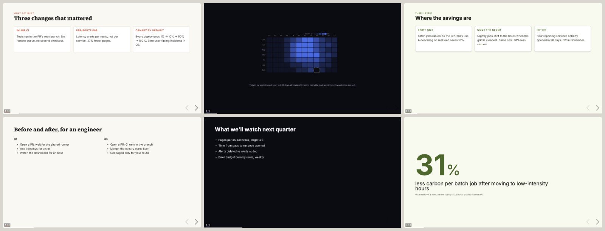
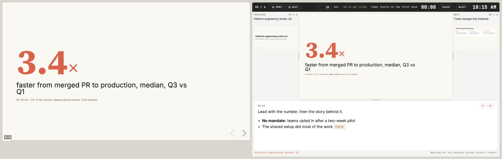
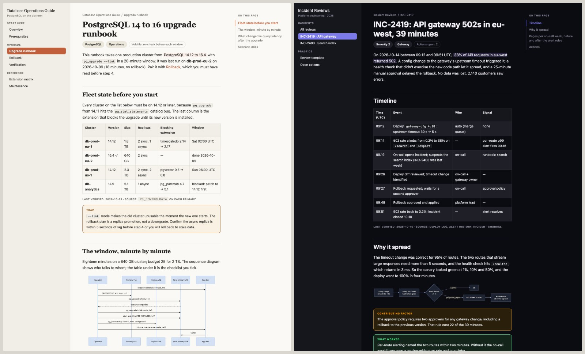

# knowledgeware

knowledgeware makes slide decks, multi-page HTML knowledge bases, and diagrams and charts that all share one visual style. Decks come out as PowerPoint files or as single-file HTML decks with a presenter view. Five built-in styles work with no setup, and you can add your own brand later so every deliverable matches it.

<table>
<tr>
<td width="33%"><a href="../../docs/images/decks.jpg"></a></td>
<td width="33%"><a href="../../docs/images/presenter.jpg"></a></td>
<td width="33%"><a href="../../docs/images/knowledgebase.jpg"></a></td>
</tr>
<tr>
<td><b>PowerPoint decks</b> (slideware)</td>
<td><b>HTML decks with a presenter view</b> (slideware)</td>
<td><b>Knowledge-base sites</b> (knowledgebase)</td>
</tr>
</table>

## Install

In Claude Code (v2.1.275 or later), one step:

```
/plugin install knowledgeware --marketplace andisab/swe-marketplace
```

Or add the marketplace once, then install by name:

```
/plugin marketplace add andisab/swe-marketplace
/plugin install knowledgeware@swe-marketplace
```

In Claude Desktop: **Customize → Plugins → Add → Add marketplace**, enter `andisab/swe-marketplace`, then install **knowledgeware**. Shell commands, team settings, zip upload and claude.ai options are in the [marketplace README](../../README.md#install).

## Try it

Ask in plain language. Claude prints the full path of every file it writes.

- *"Make a 6-slide PowerPoint deck on our Q3 platform roadmap in style-3."* The slideware skill builds a `.pptx` file in your current folder, runs its layout checks, and fixes what they find before it hands the deck over.
- *"Turn this markdown document into an HTML deck I can present from a browser."* slideware writes a deck folder whose `index.html` holds the whole deck. Open it in a browser and press `S` for the presenter view.
- *"Use the knowledgebase skill to build a field guide on PostgreSQL replication for our on-call team."* The knowledgebase skill researches the topic first and saves its notes in a `research/` folder. Then it writes a folder of linked HTML pages with navigation, diagrams and dated verification stamps.
- *"Use chartware to make a draw.io diagram of the services in this repository."* chartware lays out the diagram and opens it in draw.io, where you can keep editing it. Ask for Mermaid when the diagram goes in a README, or for SVG when you want a data chart.
- *"Use brandware to build a brand from https://example.com and set it as the default."* brandware reads the site's CSS and writes a brandbook, a Markdown file that describes a visual identity's colors, fonts and logos. From then on, every deck, site and diagram uses that brand unless you name another style.

If you don't say whether you want PowerPoint or HTML, slideware asks before it builds.

## What's inside

| Component | What it does |
|---|---|
| **slideware** skill | Builds slide decks as PowerPoint files or as single-file HTML (Reveal.js) decks. Both formats carry speaker notes, session pacing and hidden slides. |
| **knowledgebase** skill | Builds multi-page HTML knowledge bases that work offline, such as field guides, handbooks, runbooks and study guides. A site whose facts change over time, such as prices or versions, gets a maintenance page so the librarian can keep it current. |
| **chartware** skill | Draws diagrams and data charts as Mermaid, hand-written SVG, or editable draw.io files. |
| **brandware** skill | Manages the style registry the other three skills read: the built-in styles, your brands, and their logos and fonts. |
| **librarian** agent and `/knowledgeware:librarian` | Reports which facts are due for re-checking across your sites and decks, writes an update plan, and fact-checks one site against its sources. See [Keeping sites and decks current](#keeping-sites-and-decks-current). |
| `/knowledgeware:kb-maintain` | A deprecated alias for `librarian sweep`, kept so existing scheduled jobs keep running. |
| **drawio** MCP server | The official draw.io server (`@drawio/mcp`), which chartware uses to open diagrams in draw.io. `npx` fetches it the first time it runs. |

## Requirements

You need **Node.js** for deck builds, the style scripts and the draw.io server. You need **Python 3** for the deck checks, which use only the standard library. Mermaid diagrams and SVG charts need neither.

The first build of each deck runs `npm install` in the deck folder, so it needs a network connection. After that, an HTML deck runs offline, and only its Google Fonts fall back to system fonts without a connection.

### Optional tooling

None of these tools blocks a build. When one is missing, the skill still delivers and tells you which check it skipped.

| Tool | Used for | Without it | Install |
|---|---|---|---|
| **LibreOffice** | PowerPoint slide previews for the visual check | The deck still builds, without a preview review. | `brew install --cask libreoffice` · `sudo apt-get install -y libreoffice` |
| **poppler** (`pdftoppm`) | PowerPoint slide previews | Same as LibreOffice. | `brew install poppler` · `sudo apt-get install -y poppler-utils` |
| **Playwright MCP** (or Claude in Chrome) | Screenshot checks of HTML decks and diagrams | The output is still produced, without a screenshot review. | `claude plugin install playwright@claude-plugins-official` |
| **markitdown** | Reading an existing `.pptx`, to copy its style or to update it | Claude can't read the text of existing decks. | `pip install markitdown` |
| **Google Fonts access** | Installing a style's fonts for PowerPoint, and loading them in HTML | Text falls back to system fonts. | — |

## Questions and troubleshooting

For updates, context cost, safety and "plugin not found" errors, see the [marketplace FAQ](../../README.md#faq).

**Where are my files?** Decks are saved in your current folder unless you name another location, and Claude prints each file's full path. An HTML deck is a folder that holds `index.html` and the files it was built from (`slides.js`, `style.md` and `node_modules`). Only `index.html` is the deck, but if it shows local images, keep them next to it. A knowledge base is a folder of HTML pages, with the research notes in `research/` and any draw.io diagrams in `diagrams/`. A draw.io diagram opens in draw.io, and Mermaid and SVG go into the document you're working on or into their own file.

**Should I ask for PowerPoint or HTML?** Choose PowerPoint when people will edit the slides or need a `.pptx` file, which opens in PowerPoint, Keynote and Google Slides. Choose HTML when you'll present from a browser and want the presenter view with its pacing timer, or when you want to share a single file or a link.

**How do I open the presenter view?** Open the deck's `index.html` in a browser and press `S` (or `P`). The presenter view opens in a second window, and moving either window moves both. If nothing happens, allow pop-ups for the page. `N` shows the notes at the bottom of the deck itself for rehearsal, and `?` lists every key.

**How do I get a PDF of an HTML deck?** Open the deck in Chrome with `?print-pdf` added to the end of its address, then choose **File → Print → Save as PDF**. Print mode can misplace the footer on title slides. If the footers matter, ask Claude to render the slides as images instead.

**The fonts look wrong.** A PowerPoint file names its fonts but doesn't embed them, so it shows substitutes on any computer that lacks them. Before a build, slideware installs the style's missing Google Fonts and tells you which other fonts to install by hand. An HTML deck loads its fonts from Google Fonts, so without a connection it shows the fallback fonts the style names.

**Claude said a visual check was skipped.** A preview or browser tool is missing, so Claude delivered the deck or diagram without reviewing screenshots of it. Install the matching tool from [Optional tooling](#optional-tooling) and ask Claude to check the file again.

**The knowledgebase skill didn't start.** It starts only when you name it ("use the knowledgebase skill to…") or ask outright to build a field guide, handbook, runbook site or HTML study guide. A passing mention of a knowledge base doesn't start a multi-page build.

**Can I change a deck after Claude delivers it?** Yes. Ask for the change, and slideware rebuilds the deck from its source. If you edited the delivered file by hand in the meantime, slideware compares it with its last build first and carries your edits into the rebuild.

**Claude says a skill needs the whole plugin.** You installed slideware or brandware on its own, for example from a skills directory. Both need the styles and scripts in this plugin, so install the plugin with the command in [Install](#install).

---

*Everything below is optional. You don't need it to make decks, sites or diagrams.*

## Keeping sites and decks current

Facts such as prices, quotas, versions and release status go out of date. A knowledgebase site keeps a maintenance page that lists each changing fact with its source and how often to re-check it, and a deck keeps its sources and a `Last verified` date. The **librarian** agent reads those records across a library, which is any folder of sites and decks. It has three modes:

- **`/knowledgeware:librarian status [library]`** reports what's due, what's overdue and what's coming up, plus open conflicts. It writes nothing.
- **`/knowledgeware:librarian plan [library]`** writes `librarian-plan.md` at the library root. The plan lists this week's sweeps, the sources shared across items (so each is checked once), what's coming up, the backlog, and what needs a person. Each plan picks up where the last one stopped.
- **`/knowledgeware:librarian sweep <site-dir> [--dry-run]`** maintains one site. It re-checks only the facts whose check interval has passed, sends research subagents to the primary sources, and applies the changes they confirm. Then it updates the `Last verified` stamps it earned and adds a changelog row. It reports structural problems as suggestions and never restructures the site.

The library is the folder you pass, or else the folder in the `KNOWLEDGEWARE_LIBRARY` environment variable. The librarian reports on decks and plans their updates but doesn't edit them, because re-checking a deck means editing its source and rebuilding it, which slideware does.

Sweeps are designed to run weekly from cron, launchd or any other scheduler. One sweep per site and one plan for the whole library looks like this:

```bash
claude -p "/knowledgeware:librarian sweep '/path/to/site'" --permission-mode acceptEdits --model opus
claude -p "/knowledgeware:librarian plan '/path/to/library'" --permission-mode acceptEdits --model opus
```

Add `--dry-run` inside the quoted sweep command for a first run, so the sweep reports what it would change and writes nothing. Sites follow the contract in `skills/knowledgebase/references/maintenance.md`. For a site built before that contract existed, the librarian matches the sections by their content and reports where they differ. A site with no maintenance page at all can't be swept, and the librarian offers to generate one. `/knowledgeware:kb-maintain` still runs a sweep, so existing scheduled jobs keep working.

## The five built-in styles

Name a style (`style-1` to `style-5`) in any request, or let the skill choose. When you name no style and haven't set a default brand, decks use `style-1`.

| Style | Look | Use for |
|---|---|---|
| **style-1**, Editorial Light | Warm cream background, serif headings, a coral accent | Research write-ups and pitches that should read as considered |
| **style-2**, Minimal | Pure white, one geometric sans-serif, a bright indigo accent, lots of whitespace | Product announcements and design-led decks |
| **style-3**, Dark Precision | Dark background, tightly spaced sans-serif, a bright violet accent | Engineering reviews and SaaS product material |
| **style-4**, Warm Sage | Warm gray background, serif headings, outlined containers, a sage green accent | Technical write-ups and internal training |
| **style-5**, Material Olive | Material Design 3 palette of olive, sage and teal on a pale cream-green background | Product roadmaps and sustainability decks |

Each style is a folder under `styles/` with the brandbook (`brand.md`), a generic mark for light and dark backgrounds (`assets/mark.svg`, `assets/mark-dark.svg`), a stylesheet with the tokens as CSS variables and the style's motif classes (`css/<name>.css`), and a README. Each also carries its other theme: a dark palette for the four light styles, and a light palette for style-3, which is dark to begin with. The marks are original drawings, free to use, and a brand of your own replaces them.

## Using your own brand

Ask Claude to *"use brandware to add a brand for example.com"*. brandware derives the style from the site, gathers its logos into the brand's folder, records where each one came from, and saves the brandbook in your brands directory. The derivation reads the site's HTML and CSS and picks colors and fonts by how often they appear, so compare the result with the live site before you rely on it. To make the brand your default, ask Claude to *"set example as the default brand"*, or run `echo example > $BRANDS/DEFAULT`.

`$BRANDS` here means your brands directory (see the next section), or `<plugin-root>/styles/brands` if you haven't set one. You can also add a brand by hand, from the plugin root:

```bash
mkdir -p $BRANDS/example/assets

# 1. Derive from a live website (a heuristic, so review the result by hand)
node scripts/derive-style.js https://example.com -o $BRANDS/example/brand.md

# 2. Import an existing .md or .css brandbook, or fetch one from Google Drive
cp ~/my-brandbook.md $BRANDS/example/brand.md
bash scripts/fetch-resource.sh <drive-share-url> $BRANDS/example/brand.md

# 3. Write one by hand, following skills/brandware/references/brandbook-spec.md and the acmecorp example
```

Logos and wordmarks go in the brand's `assets/` folder, and a stylesheet or starters can sit beside them in `css/` and `starters/`. If you have a design kit or brand plugin already, copy its brandbook, logos and stylesheet into this shape and note where they came from in the folder's README. slideware installs a brand's Google Fonts when it builds a PowerPoint deck. To install them yourself, run `bash scripts/install-fonts.sh example`.

## Bring your own brands directory

Brands stored inside the plugin's install folder are replaced whenever the plugin updates. Keep your brands in a directory you own instead, anywhere on disk, and point the plugin at it in `~/.claude/settings.json`. Set it there rather than in your shell profile, so every Claude Code session has it:

```jsonc
// ~/.claude/settings.json
{
  "env": {
    "KNOWLEDGEWARE_BRANDS_DIR": "~/my-brands"
  }
}
```

The directory has the same layout as the plugin's own brands folder:

```
~/my-brands/
├── DEFAULT                # optional: one line naming your go-to brand, e.g. "acmecorp"
└── <name>/
    ├── brand.md           # the brandbook
    ├── tokens.json        # a cache derived from the brandbook (regenerated automatically)
    ├── assets/            # logos, marks, wordmarks
    ├── css/<name>.css     # optional stylesheet
    └── README.md          # optional: provenance and notes
```

Brands in the older flat layout (`<name>.md` next to `tokens/<name>.json` and `<name>/assets/`) keep working; move one into a folder whenever you edit it.

Everything in this directory survives plugin updates, and it works well as a private git repository. Its entries win over same-named entries in the plugin, and its `DEFAULT` file wins over the plugin's.

Without the environment variable, brands go in `styles/brands/` inside the plugin install, which every plugin update replaces. In that setup, keep the originals somewhere else and copy them back after each update (`cp -Rp ~/my-brands/. <plugin-root>/styles/brands/`). `styles/brands/README.md` has the details.

## How style resolution works

When a request names a style or brand, the skills look for it in three places, in this order:

```
$KNOWLEDGEWARE_BRANDS_DIR/     # your directory (checked first)
styles/brands/                 # brandbooks inside the plugin install
styles/                        # the five built-in styles (checked last)
```

The first match wins. When a request names nothing, the skills look for a `.knowledgeware` file in the project or any parent directory (one line naming a brand, for a repository that's always in one brand), then the brand in the `DEFAULT` file, with your directory's file winning over the plugin's. With no `DEFAULT` file, each skill uses its own fallback: `style-1` for decks, the template's palette for knowledge bases, and the default styling for diagrams. Each skill maps the same brandbook onto its own medium (`skills/brandware/references/consumer-mappings.md`), so a deck, a site and a diagram in one brand look like parts of one set. To list what's installed, run `node scripts/list-styles.js` (with `--brands`, `--names` or `--json`).

---

Part of [swe-marketplace](../../README.md). Changes are in the [changelog](../../CHANGELOG.md). MIT license.
